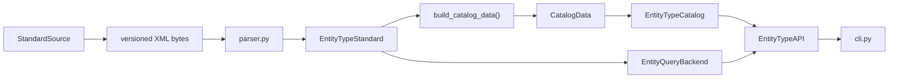

# Code layout

The package follows the data from the source standard to the user-facing API:

## Modules

- `sources.py` defines the versioned retrieval protocol and the bundled XZ source.
- `snapshots.py` verifies the index and compressed pack, then retrieves one
  edition's XML bytes on demand.
- `reference.py` defines immutable Pydantic models for the standard's XML data.
- `parser.py` converts XML into an `EntityTypeStandard` and reports source errors.
- `_paths.py` privately normalizes file inputs for parser and catalog methods.
- `projection.py` contains the transformations from a standard to lookup indexes.
  `build_catalog_data()` returns a frozen `CatalogData` with read-only mappings
  and typed `CatalogChild` records keyed by entity prefix.
- `catalog.py` provides lookup operations over `CatalogData`. It holds the
  immutable projection and two query caches; rebuilding data happens in the projection.
- `model.py` defines the seven-field DIS `EntityType` and its key, string, and
  byte representations.
- `codes.py` defines nominal integer types so kind, country, domain, and
  hierarchy-code mappings remain distinct to static type checkers.
- `api.py` combines catalog operations into immutable Pydantic results.
- `query_backend.py` defines the swappable source-record query contract and the
  default in-memory implementation with per-field postings and range indexes.
- `inspection.py` queries the preserved edition source model for table, row,
  UUID, metadata, and hierarchy evidence without flattening away source ranges.
- `comparison.py` builds histories and identity-aware pairwise differences by
  reading editions through the versioned source interface.
- `cli.py` handles arguments, output formatting, and process exit codes.

## Processing rule

Data transformations take explicit inputs and return new data models. The
projection does not mutate the parsed standard or an existing catalog. When a
catalog is reinitialized, it builds the replacement projection first and then
swaps it in, so failed builds leave the existing catalog usable. Query caches
stay inside the lookup facade and do not change the projected data.

Retrieval, parsing, and projection are separate steps: `StandardSource` selects
bytes by version; the parser constructs the source model; the projection builds
the lookup view. `EntityTypeAPI.iter_editions()` applies one query to selected
versions without eagerly parsing every edition.

Exact lookup and hierarchy choices use the mapping indexes in
`EntityTypeCatalog`. Structured entity searches go through the independent
`EntityQueryBackend` protocol. `MappingEntityQueryBackend` is the default and
indexes each entity-code field separately while retaining stable source order.
The two most recently used bundled `CatalogData` projections are shared in-process;
they are immutable, while each catalog instance keeps its own mutable query caches.
An alternate backend receives the edition inspector and an immutable query
request and returns a count plus a page of source records. This lets another in-memory
index or database implementation replace query execution without changing the
public result model or CLI. Compare warm indexed queries with a record scan using
`python -m tools.benchmark_entity_queries`; its timings are local measurements,
not performance guarantees. The [query performance notes](contributing/query-performance.md)
record the earlier optimization and persistent-cache investigation.

`EntityTypeAPI.warmup()` builds the selected query backend's indexes explicitly.
The CLI's global `--warmup` flag does this in the same process before executing
the requested API-backed command; the in-memory cache does not persist between
separate CLI invocations. Without warmup, the mapping backend scans source rows
for a query instead of paying index construction during that request.

Measure cold compressed-snapshot retrieval and API construction for selected
editions with `python -m tools.benchmark_snapshot_loading`. Each sample runs in
a fresh process so the edition cache cannot make later samples appear cold.
The bundled archive is one solid XZ stream: offsets identify edition bytes in
the uncompressed stream, so seeking to an older release can decompress earlier
editions first. The [measured run and method](contributing/snapshot-loading.md)
are local observations, not performance guarantees.

`comparison.py` flattens source-backed entity and enumeration values into
versioned records. It matches unique UUIDs first, then code paths or
table/value keys, and reports changes without mutating the parsed source or
lookup projection. History and pairwise-diff operations load only requested
editions.
